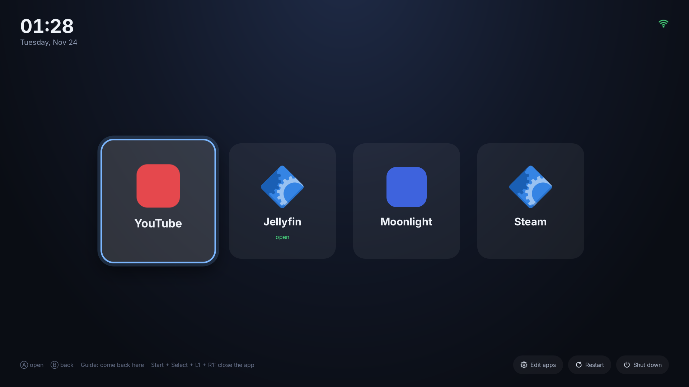
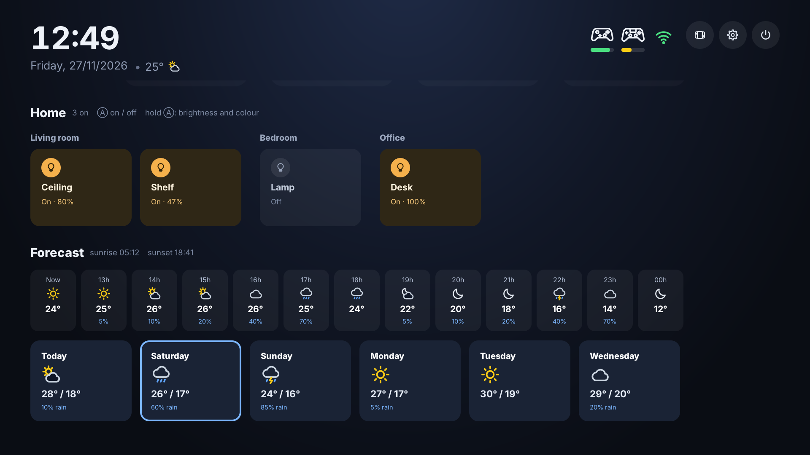

> [!WARNING]
> **Beta, not a finished product.** This is an early version built and tested on one home setup. Expect rough edges: some features have only been tested against simulated hardware, and file formats or install steps may still change between versions. Back up `~/.config/htpc-launcher/apps.json` before updating, and please report problems in [Issues](https://github.com/murilosalviati/htpc-launcher/issues).

HTPC Launcher: a gamepad-driven TV home screen for Ubuntu with GNOME on Wayland.

## What's new in 0.1.0-beta.12

- **Settings → Audio gathers the sound settings.** Its first line, **Volume shortcut changes**, chooses what Start + Select + ↑ / ↓ changes, one or the other: **System (Ubuntu)** or **TV (Home Assistant)**. Below it, the sound output and Bluetooth pairing. The choice moved there from the Home Assistant menu; yours is kept.
- **The TV's volume shows a TV on the indicator,** so it isn't mistaken for the system's (GNOME's volume indicator looked the same for both).

### Also in 0.1.0-beta.11

- **Continue watching** in Jellyfin's row, **LT / RT** to switch tabs, the **screensaver** (closed by any button or by turning a gamepad on), the **forecast** under the lights, **lights by room side by side**, **reordering apps** with LB / RB.
- **PlayStation controllers:** ✕ ○ □ △ and L1 / R1 / L2 / R2 in the hints.
- **Wake the PC Steam streams from** when it opens: give the Steam app a `wake_on_lan` in `apps.json`. See [Configuration](https://github.com/murilosalviati/htpc-launcher/blob/main/docs/configuration.md#apps).

Gamepads drawn with their battery, the TV input button and turning the gamepads off with the TV came in [0.1.0-beta.10](https://github.com/murilosalviati/htpc-launcher/releases/tag/v0.1.0-beta.10).

The new home screen arrived in [0.1.0-beta.8](https://github.com/murilosalviati/htpc-launcher/releases/tag/v0.1.0-beta.8): films and series from Jellyfin, Steam games, your lights, the power menu.

This product uses the TMDB API but is not endorsed or certified by TMDB.

The full list is in [CHANGELOG.md](https://github.com/murilosalviati/htpc-launcher/blob/main/CHANGELOG.md).

## Install or update

1. Download **htpc-launcher-0.1.0-beta.12.tar.gz** below and extract it: `tar xzf htpc-launcher-*.tar.gz`. `SHA256SUMS` lets you check it: `sha256sum -c SHA256SUMS`.
2. Run `./install.sh` inside the extracted folder. An existing `apps.json` is kept.
3. **Log out and back in** if you are coming from beta.5 or older: GNOME only loads the extension's version 7 at login. On a first install, then run `gnome-extensions enable htpc-launcher@htpc`. The launcher starts by itself at login.

From beta.6 on, updates can also be installed from **Settings → Updates**.

Requirements:
- **System:** Ubuntu with GNOME on Wayland. It's tested on GNOME Shell 50.
- **Packages:** the installers add `python3-evdev`, `python3-jeepney`, `python3-gi` and `gir1.2-gtk-4.0` if they are missing.
- **Optional:**
  - a Bluetooth adapter, for pairing;
  - PipeWire or PulseAudio, for the volume shortcut and audio output;
  - Home Assistant, for TV control, cinema mode and your lights;
  - Jellyfin (and a free TMDB key), for films and series on the home screen.

See the [documentation](https://github.com/murilosalviati/htpc-launcher/blob/main/docs/README.md) for everything else.
