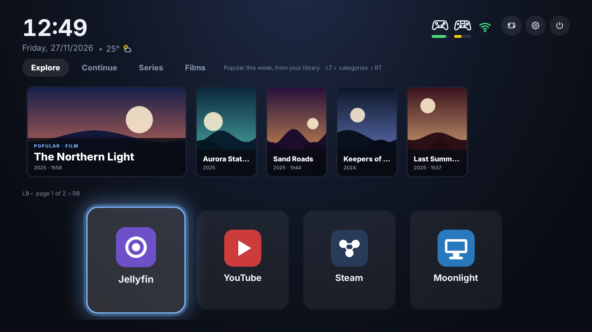
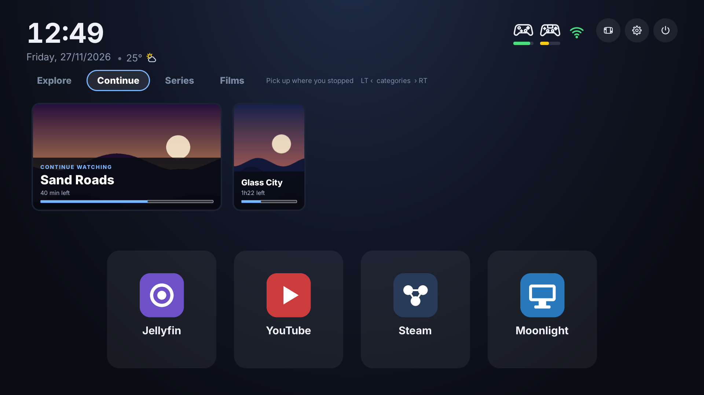
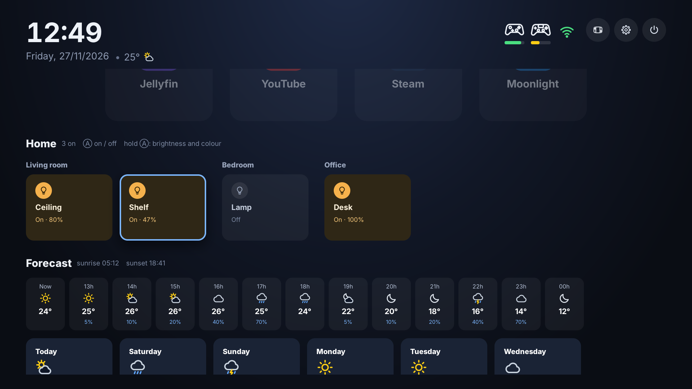
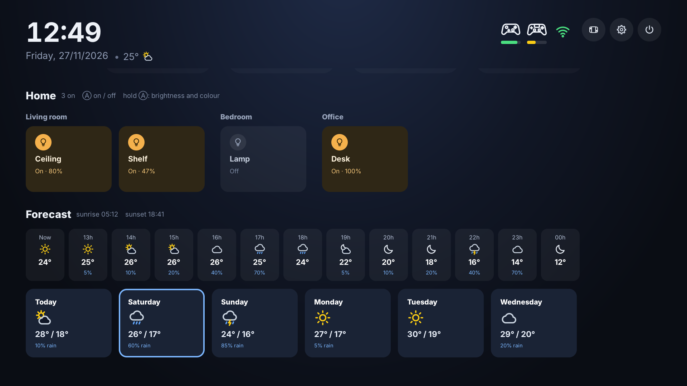
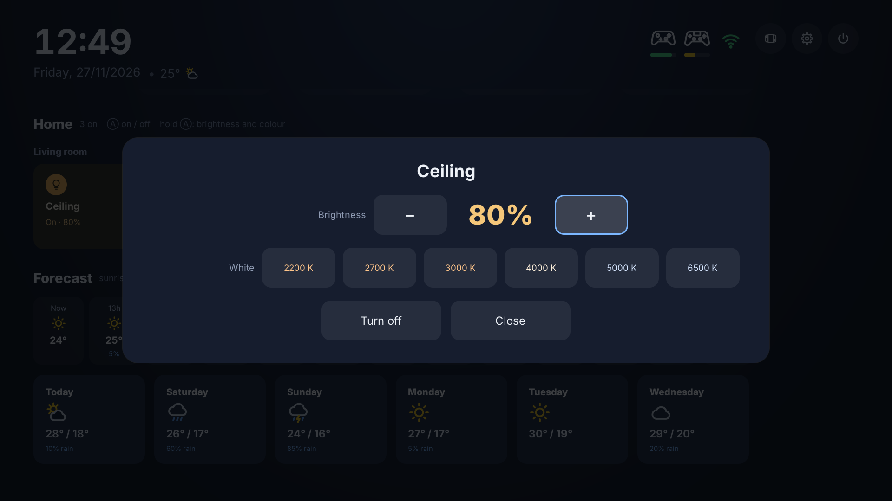
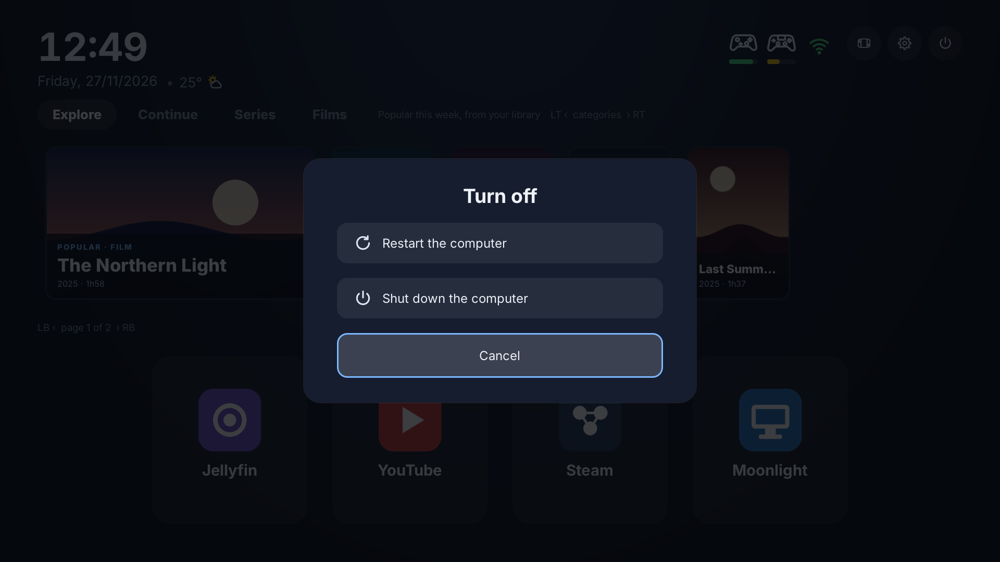
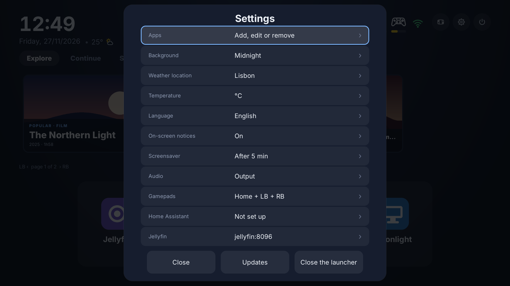
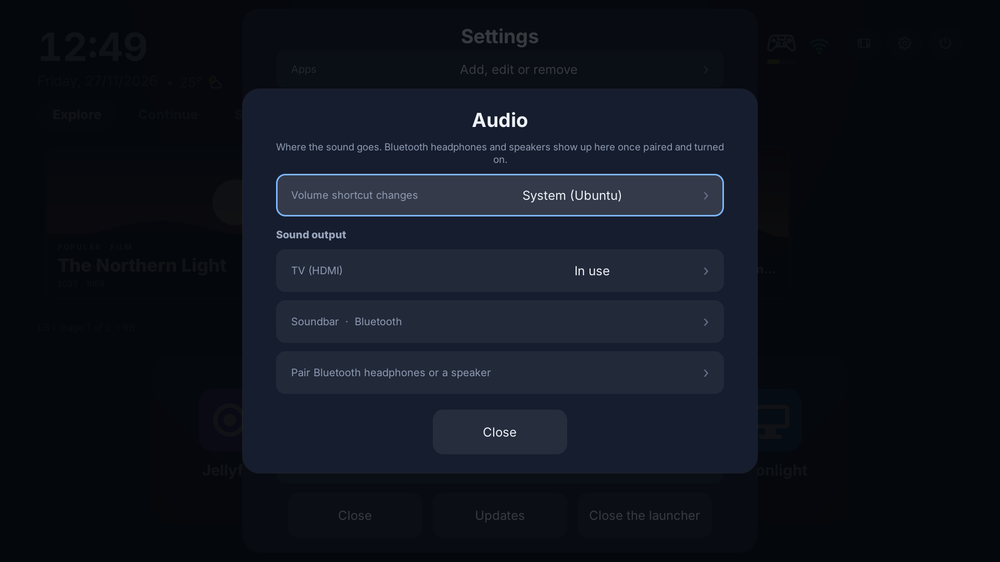
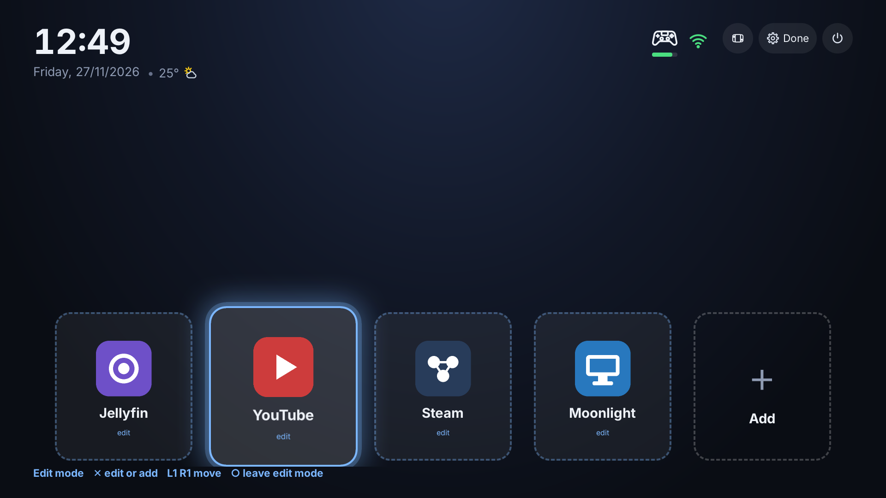
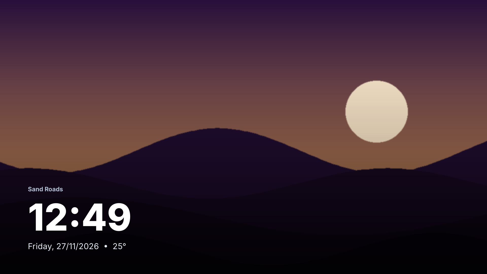

# HTPC Launcher

> [!WARNING]
> **Beta, not a finished product.** Versions are `0.x` pre-releases (`0.1.0-beta.1`, ...). It is built and tested on one home setup, parts of it have only been tested against simulated hardware, and the configuration format or install steps may still change. Back up `~/.config/htpc-launcher/apps.json` before updating.

A gamepad-driven home screen for a living-room PC running Linux with GNOME on Wayland (Ubuntu, Debian, Fedora, Arch, openSUSE). It works with Xbox, 8BitDo and PlayStation controllers, and looks and behaves like a TV or console home screen.


*Everything in these screenshots is made up by `tests/make_preview.py`: the app icons are placeholders and the films and series are invented. On a real install the launcher shows each app's own icon, or images you choose.*

## Features

- **A home screen made for the couch:**
  - one tile per app, with a glow and press animations;
  - across the top: the clock, the date with the weather, each connected gamepad drawn by kind (Xbox, PlayStation or plain) with its battery under it, the network status, and the TV input, Settings and power buttons;
  - sizes that follow the screen, from 1080p to 4K.
- **Films, series and games above the apps (optional):** the row follows the app in focus.
  - **Jellyfin:** Explore (what's trending this week on TMDB that is in your library, new titles only), Continue (what you stopped halfway, with a progress bar and the time left), Series and Films (the newest on your server).
  - **Steam:** your recently played games, including the ones you stream with Remote Play. Opening Steam can also wake the PC the games stream from, through Home Assistant.
  - LT / RT switch tabs, LB / RB turn the page.
- **Below the apps:** your lights by room, side by side (with Home Assistant), and the forecast: the next hours, the next days, sunrise and sunset.
- **Screensaver:** after a few minutes without a press, your films' and series' pictures with a big clock. Any button, or turning a gamepad on, brings the launcher back.
- **Apps open in full screen and resume, never duplicate.** Selecting an app that is already running brings it back. Steam opens in Big Picture.
- **Shortcuts in any app:**

  | Shortcut | What it does |
  |---|---|
  | Home + LB + RB | Back to the launcher (pausing the video). |
  | Start + Select + LB + RB | Close the app. |
  | Start + Select + ↑ / ↓ | Volume: the system's, or the TV's through Home Assistant (Settings → Audio). |

  The first two can be changed from Settings. Hold Start + Select alone and they all show up on screen, over any app.
- **Over whatever is playing:** a short notice when a gamepad connects or disconnects, when a battery gets low, or when the internet drops or comes back. They show even over full-screen video and games.
- **Every gamepad speaks its own language:** with PlayStation controllers, the hints say ✕ ○ □ △ and L1 / R1 / L2 / R2.
- **Settings from the couch:**
  - apps, with an on-screen keyboard: add, edit, remove, and **reorder** them (LB / RB in edit mode);
  - background color, weather location, °C/°F, and English or Brazilian Portuguese;
  - **Bluetooth gamepad pairing**, newer Xbox controllers (Bluetooth LE) included;
  - audio: what the volume shortcut changes, the sound output, Bluetooth headphones and speakers;
  - the screensaver;
  - shortcuts;
  - Home Assistant and Jellyfin.
- **Home Assistant (optional):**
  - **The TV:** turning a gamepad on, or pressing a button, wakes the TV and switches it to the launcher; while it's off, the gamepad only wakes it. Turning the TV off from the power menu also turns the Bluetooth gamepads off.
  - **Another input:** a button switches the TV to a console on another HDMI input.
  - **The TV's volume** from the volume shortcut, when you choose it in Settings → Audio.
  - **Wake a PC** when an app opens, such as the one Steam streams games from (a Wake-on-LAN button, an automation or a script).
  - **Your lights by room,** under the apps: Ⓐ turns one on or off, holding Ⓐ opens its brightness, white temperature and colour. Scenes sit there too.
  - **Cinema mode** dims the lights while a video plays.
- **Per-app resolution:** for example, 4K for movies in Jellyfin and 1440p at 60 Hz everywhere else, switching by itself.
- **Updates from the couch:** the launcher and the Flatpak apps, from Settings.
- **Small touches:**
  - the mouse pointer hides while you use the gamepad;
  - one power button turns off the TV (through Home Assistant), restarts or shuts down the computer, and turning off the TV puts the launcher back at its start;
  - your own icons can replace the launcher's (`~/.config/htpc-launcher/icons/`).

The default configuration has VacuumTube (YouTube's TV interface), Jellyfin Desktop, Moonlight and Steam, all as Flatpaks.

<p>
  
  
</p>

## Screenshots

All made up by `tests/make_preview.py`, like the one above.

| | |
|---|---|
|  |  |
| **The home screen.** The row above the apps follows the app in focus; LT / RT switch tabs, LB / RB turn the page. | **Continue watching.** What you stopped halfway, with a progress bar and the time left. |
|  |  |
| **Lights by room**, side by side under the apps (Home Assistant). | **The forecast:** the next hours, the next days, sunrise and sunset. |
|  |  |
| **Hold Ⓐ on a light** for its brightness, white temperature and colour. | **One power button:** turn off the TV, restart or shut down. |
|  |  |
| **Settings**, all from the gamepad. | **Audio:** what the volume shortcut changes, the sound output, Bluetooth pairing. |
|  |  |
| **Edit mode**, here with a PlayStation controller: the hints say ✕ ○ and L1 R1. | **The screensaver:** your films' pictures with a big clock. |

## Quick start

1. Download the newest `htpc-launcher-<version>.tar.gz` from the [Releases page](https://github.com/murilosalviati/htpc-launcher/releases).
2. Extract it and install:

   ```bash
   tar xzf htpc-launcher-*.tar.gz && cd htpc-launcher-*/
   ./install.sh
   ```

3. Log out and back in. On a first install, then run `gnome-extensions enable htpc-launcher@htpc`.

The launcher starts by itself at login. Requirements, updating, and the notes for Jellyfin and Steam are in **[Installation](docs/installation.md)**.

## Documentation

| | |
|---|---|
| **[Installation](docs/installation.md)** | Requirements, installing, updating, app notes, uninstalling. |
| **[Using the launcher](docs/using.md)** | The home screen, notices, and every Settings menu. |
| **[Gamepads](docs/gamepads.md)** | Shortcuts, volume, changing the shortcuts, Bluetooth pairing, batteries. |
| **[Configuration](docs/configuration.md)** | The `apps.json` reference. |
| **[Home Assistant](docs/home-assistant.md)** | TV on/off with the gamepad and from the launcher. |
| **[Troubleshooting](docs/troubleshooting.md)** | Logs, common problems, working over SSH. |
| **[Development](docs/development.md)** | Architecture, the extension's D-Bus API, backends, tests, releases. |

What changed in each version is in the **[CHANGELOG](CHANGELOG.md)**.

## License

HTPC Launcher is free software: you can redistribute it and/or modify it under the terms of the GNU General Public License as published by the Free Software Foundation, either version 3 of the License, or (at your option) any later version. See [LICENSE](LICENSE).

It is distributed in the hope that it will be useful, but WITHOUT ANY WARRANTY; without even the implied warranty of MERCHANTABILITY or FITNESS FOR A PARTICULAR PURPOSE.

App names such as YouTube, Jellyfin, Moonlight and Steam belong to their owners; this project is not affiliated with them.
