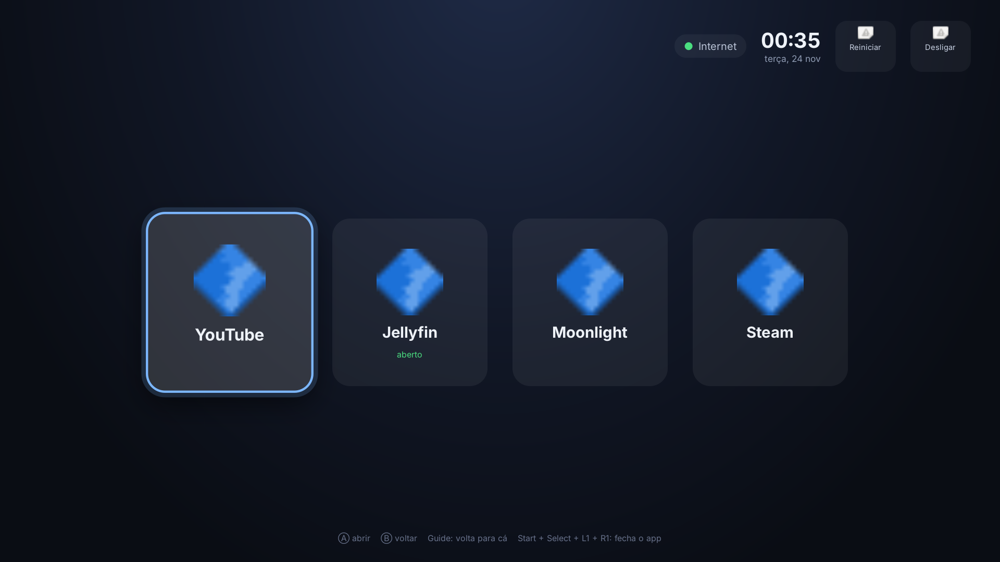

# HTPC Launcher

Front end para um HTPC com Ubuntu e GNOME (Wayland), controlado por controle de Xbox, 8BitDo ou PS4.



- **Launcher em tela cheia:** um botão por app no centro. No canto superior direito ficam o indicador de internet, o relógio e os botões de reiniciar e desligar (com confirmação).
- **Retoma a sessão:** escolher um app que já está aberto traz a janela dele de volta em vez de abrir outro.
- **Guide** (botão Xbox / Home / PS): pausa o vídeo, se houver um tocando, e volta ao launcher. O app continua aberto por trás.
- **Start + Select + L1 + R1:** fecha o app em foco. No Moonlight, o 1º toque encerra o stream e um 2º toque em até 15 s fecha o app.

- **Editar apps** (engrenagem no rodapé): entra no modo de edição. Ⓐ num app abre o editor (nome, aplicativo e ícone; tem também Remover), Ⓐ em "+ Adicionar" cria um atalho novo, Ⓑ sai. O nome é digitado num teclado na tela (Ⓧ apaga, Ⓨ põe espaço), ou num teclado físico. O aplicativo vem da lista dos instalados, e o ícone pode ser o do próprio app ou uma imagem de `~/.local/share/htpc-launcher/icones-apps/`. Tudo é salvo no `apps.json`. Acima de 5 apps, a grade quebra em mais linhas.

Apps configurados: VacuumTube (YouTube), Jellyfin Desktop, Moonlight e Steam Big Picture (os quatro em Flatpak).

## Partes

| Pasta | O que é |
|---|---|
| `gnome-extension/` | Extensão do GNOME Shell `htpc-launcher@htpc`. No Wayland só o GNOME pode trazer janelas para a frente; ela oferece isso pelo D-Bus (`org.htpc.Launcher`). |
| `controle/` | Serviço systemd de usuário que lê os controles (evdev) e cuida do guide e do combo de fechar. |
| `launcher/` | O launcher, em Python + GTK4 (`launcher.py`), com o modo de edição em `edicao.py`. |
| `config/apps.json` | Lista de apps, compartilhada pelo launcher e pelo serviço. Fica em `~/.config/htpc-launcher/apps.json`. |
| `testes/` | Testes com a extensão e o player de mídia simulados. |

## Instalar

Instale nesta ordem:

```bash
gnome-extension/install.sh   # depois, novo login (no servidor: sudo systemctl restart gdm)
                             # e: gnome-extensions enable htpc-launcher@htpc
controle/install.sh
launcher/install.sh          # abre sozinho no próximo login; agora: gtk-launch htpc-launcher
```

Dependências (os scripts instalam se faltar): `python3-evdev`, `python3-jeepney`, `python3-gi`, `gir1.2-gtk-4.0`.

No Steam, desligue a função do botão guide para ele não responder junto com o launcher.

## apps.json

```json
{
  "nome": "YouTube",
  "id": "rocks.shy.VacuumTube",
  "abrir": ["flatpak", "run", "rocks.shy.VacuumTube", "--ozone-platform=wayland"],
  "pausar_ao_sair": true
}
```

| Campo | Para que serve |
|---|---|
| `id` | Nome da janela: id do Flatpak, do `.desktop` ou WM_CLASS. `gnome-extension/testar.sh` mostra o nome de cada janela aberta. |
| `outros_ids` | Nomes alternativos da mesma janela. |
| `abrir` | Comando para abrir o app. |
| `fechar` | Comando para fechar o app, quando fechar a janela não basta. |
| `espera_fechar` | Segundos até forçar o fechamento (padrão: 3). |
| `janelas_preferidas` | Para apps com várias janelas, como o Steam: títulos que o launcher prefere trazer para a frente, na ordem. Sem eles, vem a janela usada por último. |
| `pausar_ao_sair` | Pausa o vídeo (MPRIS) quando o guide é apertado. |
| `fechar_em_dois_toques` | O 1º toque do combo fica com o app; o 2º fecha. |
| `icone`, `desktop` | Trocam o ícone usado no launcher. |

## Diagnóstico

```bash
gnome-extension/testar.sh               # janelas abertas e app em foco
journalctl --user -fu htpc-controle     # o que o serviço do controle está fazendo
journalctl --user -f -o cat /usr/bin/gnome-shell   # erros da extensão
```

Pelo SSH, exporte antes `XDG_RUNTIME_DIR=/run/user/1000`, `DBUS_SESSION_BUS_ADDRESS=unix:path=/run/user/1000/bus` e `WAYLAND_DISPLAY=wayland-0`.

## Testes

```bash
dbus-run-session -- python3 testes/testar_controle.py
xvfb-run -s "-screen 0 1920x1080x24" dbus-run-session -- python3 testes/testar_launcher.py
```
