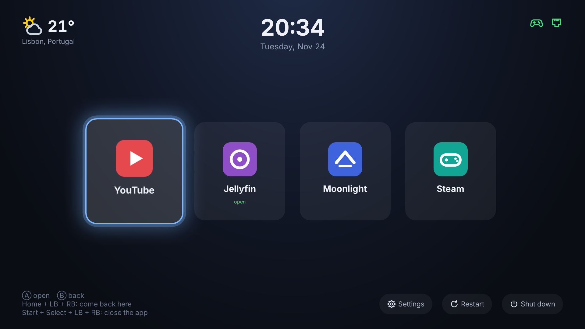

# HTPC Launcher documentation

HTPC Launcher turns a PC running Ubuntu with GNOME into a TV box you use from the couch with a gamepad. It has a full-screen home screen with your apps, shortcuts that work inside any app, and optional control of the TV through Home Assistant.

> [!WARNING]
> **Beta.** Versions are `0.x` pre-releases, built and tested on one home setup. Back up `~/.config/htpc-launcher/apps.json` before updating.

## Guides

| Page | What's in it |
|---|---|
| **[Installation](installation.md)** | Requirements, installing, updating, the Jellyfin and Steam notes, uninstalling. |
| **[Using the launcher](using.md)** | The home screen, the top bar, the footer, notices, and every Settings menu. |
| **[Gamepads](gamepads.md)** | Supported gamepads, the shortcuts, volume, changing the shortcuts, pairing over Bluetooth, batteries. |
| **[Configuration](configuration.md)** | The `apps.json` reference: per-app fields and every top-level setting. |
| **[Home Assistant](home-assistant.md)** | Waking the TV with the gamepad, the "Turn off TV" button, ignoring the gamepad while the TV is off. |
| **[Troubleshooting](troubleshooting.md)** | Logs, common problems and their fixes, working over SSH. |
| **[Development](development.md)** | How it's built: components, the GNOME extension's D-Bus API, backends, porting to another OS, tests, releases. |

What changed in each version is in the [CHANGELOG](../CHANGELOG.md).

## At a glance

- **Home screen:** one tile per app, with the clock, the weather, gamepad and battery icons, and the network status.
- **Shortcuts in any app:**

  | Shortcut | What it does |
  |---|---|
  | Home + LB + RB | Back to the launcher. |
  | Start + Select + LB + RB | Close the app. |
  | Start + Select + ↑ / ↓ | Volume up or down. |

- **Settings, from the couch:** apps, background, weather, units, language, notices, gamepads (pairing and shortcuts), and Home Assistant.
- **Over full-screen apps:** notices and the volume indicator show on top of any video or game.

[← Back to the project page](../README.md)
