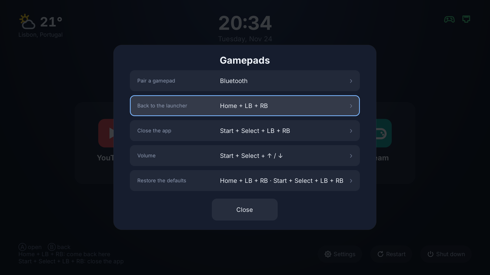
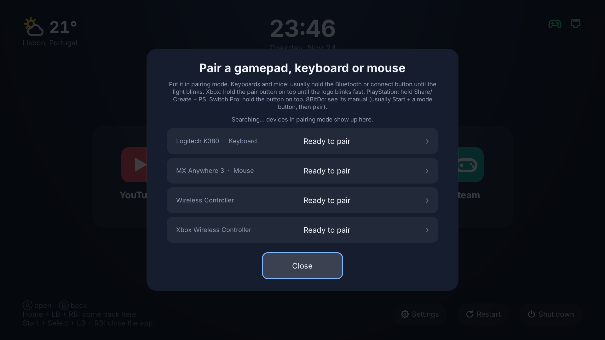

# Gamepads

[← Documentation](README.md)

## Supported gamepads

Any gamepad Linux sees as one works. It's tested with Xbox controllers, and these also work:

- **8BitDo**, in XInput or Switch mode;
- **PlayStation**: DualShock 4 and DualSense;
- **Nintendo-style** gamepads.

A gamepad can be connected by USB cable, by Bluetooth, or through its own wireless receiver, such as the Xbox Wireless Adapter or an 8BitDo receiver.

The face buttons always go **by position**: the bottom one is Ⓐ (✕ on PlayStation, B on Nintendo), and the right one is Ⓑ. Xbox drivers report X and Y swapped, and the launcher swaps them back, so Ⓨ (top) types a space and Ⓧ (left) deletes on the on-screen keyboard, whatever the brand.

Virtual gamepads, such as Steam Input's, are ignored, so one press is never counted twice.

## Shortcuts

These work everywhere, inside any app, because a background service (`htpc-controller`) runs them. The table names the buttons Xbox-style.

| Shortcut | PlayStation | Nintendo | What it does |
|---|---|---|---|
| **Home + LB + RB** | PS + L1 + R1 | Home + L + R | **Back to the launcher.** It pauses the video that is playing, in apps set to do so. The app keeps running behind the launcher. |
| **Start + Select + LB + RB** | Options + Share + L1 + R1 | + + − + L + R | **Close the app** and go back to the launcher. |
| **Start + Select + ↑** | Options + Share + ↑ | + + − + ↑ | **Volume up.** |
| **Start + Select + ↓** | Options + Share + ↓ | + + − + ↓ | **Volume down.** |

- **The guide button alone** (Xbox, PS or Home) is left to the apps. In Steam's Big Picture it opens Steam's menu.
- **Closing a streaming app:** for apps like Moonlight, the first close combo goes to the app, where it ends the stream. A second one within 15 seconds closes the app. This is the `close_on_second_press` setting in [Configuration](configuration.md).
- **Opening the launcher again:** if the launcher was closed from Settings, the "back to the launcher" shortcut starts it again.
- **TV off:** with [Home Assistant](home-assistant.md) set up to read the TV's state, the shortcuts are ignored while the TV is off. The first press only wakes the TV.

### Volume

- **Step:** each press changes the volume by 5 points, and holding the arrow keeps going.
- **Range:** it stops at 100%. Raising the volume also unmutes it.
- **Indicator:** GNOME's own volume indicator shows the level on top of anything, full-screen apps included.
- **Sound system:** it uses PipeWire (`wpctl`, Ubuntu's default) or PulseAudio (`pactl`) on the default output.
- **In the launcher:** while Start + Select are held, the arrows change the volume and don't move the selection.

## Changing the shortcuts

In **Settings → Gamepads**:

1. Select **Back to the launcher** or **Close the app**.
2. **Hold the new buttons together for 2 seconds.** The screen shows what you're holding. To cancel, hold Ⓑ alone.
3. Confirm with **Use**.

Rules for a new combo:

- It needs **two buttons or more**, from Home, Start, Select, LB, RB, A, B, X and Y. The d-pad can't be used.
- The two combos can't **contain each other**. Otherwise pressing one would also fire the other.
- It can't be just **Start + Select**, because that's the start of the volume combos.

**Restore the defaults** brings back Home + LB + RB and Start + Select + LB + RB. The volume shortcut is fixed.

Changes apply right away, in the launcher and in the background service. Settings → Gamepads always shows the current combos. They are saved as `shortcuts` in `apps.json`, as described in [Configuration](configuration.md#top-level-settings).

## Pairing over Bluetooth (gamepads, keyboards, mice)

You need a Bluetooth adapter, either built in or a USB one. Ubuntu supports most of them out of the box. The TP-Link UB500, for example, works without any setup.

1. Open **Settings → Gamepads → Pair a gamepad, keyboard or mouse**. The launcher turns Bluetooth on and starts searching.
2. **Put the gamepad in pairing mode:**

   | Gamepad | How |
   |---|---|
   | Xbox | Turn it on, then hold the small pair button on top until the Xbox logo blinks fast. |
   | PlayStation (DualShock 4, DualSense) | Hold Share (or Create) and PS until the light bar flashes. |
   | Switch Pro Controller | Hold the small sync button on top. |
   | 8BitDo | Pick a mode with Start + a mode button (see its manual), then hold its pair button. |
   | Keyboards and mice | Usually hold the Bluetooth or connect button until the light blinks. |

3. It appears in the list as **Ready to pair**. Keyboards and mice are marked as such.
   - Headphones and speakers are left out of this list. Pair them from Settings → **Audio**, as described in [Using the launcher → Audio](using.md#audio).
   - Nameless devices are left out too.
4. Select it with **Ⓐ**. The launcher pairs, trusts and connects it, and it shows **Connected**.

The gamepad is **trusted**, so after that you just turn it on and it reconnects by itself.

**To remove a paired gamepad,** select it in the same list and choose **Forget**. Closing the screen stops the search.

**Without an adapter,** the screen explains the alternatives:

- a **USB cable**;
- the gamepad's **own receiver**: plug it in, press the button on the receiver, then the gamepad's pair button.

> Keyboards that ask you to type a code to pair can't be paired from the launcher yet. Pair those once from GNOME's Settings → Bluetooth.
>
> Pairing goes through BlueZ, Linux's Bluetooth service, the same way GNOME's own Bluetooth settings do. If a gamepad won't pair from the launcher, try once from GNOME's Settings → Bluetooth with a mouse. Some gamepads, like newer Xbox ones over Bluetooth LE, may need an update from their maker first.

## Batteries

Wireless gamepads that report their charge get a battery icon in the top bar. You'll also get a notice when one drops to 20% and again at 10%. Gamepads on a cable report no charge, so they get no icon.

## Jellyfin and other apps

Apps read the gamepad themselves, and the launcher's shortcuts work on top of them. If a gamepad does nothing inside a Flatpak app, the app probably can't see input devices; see [Installation → App notes](installation.md#app-notes).
