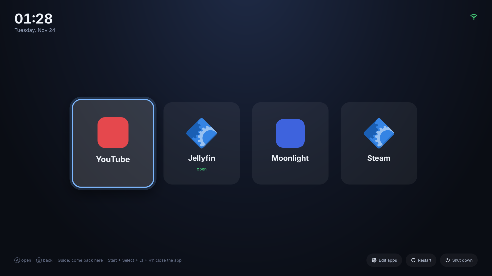
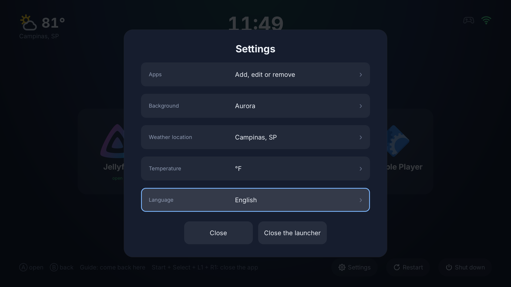

# Using the launcher

[← Documentation](README.md)

## The home screen

### Tiles

The middle of the screen has one tile per app. Move between them with the d-pad or the left stick, and press **Ⓐ** to open an app.

- **Selection:** the selected tile lifts and glows.
- **Opening:** pressing Ⓐ plays a short "button pressed" animation, and the tile pulses green while the app opens.
- **Already running:** a tile shows **open** under its name when the app is running. Selecting it brings back the existing window instead of starting a second copy.
- **Full screen:** apps open in full screen. Steam is the exception, because its Big Picture already is full screen.
- **Layout:** after 5 apps the grid wraps onto more rows.

### The top bar

- **Left:** the weather (an icon, the temperature and the place), once you set a location. At night the sun becomes a moon. It updates every 30 minutes.
- **Middle:** the clock and the date.
- **Right:**
  - **Gamepads:** an icon that lights up when a gamepad is connected (USB, Bluetooth or a wireless receiver). With more than one connected, it shows how many.
  - **Batteries:** one battery icon per wireless gamepad that reports its charge, from empty (red) to full, with a bolt while charging. A gamepad on a cable reports no charge, so no icon shows for it.
  - **Network:** a cable symbol on a wired connection, or Wi-Fi bars on Wi-Fi. Text appears only when the connection is limited or down.

Everything around the edges keeps the same share of the screen on 1080p, 1440p or 4K. The icons are vectors, so they stay sharp.

### The footer

- **Left:** reminders of the buttons and the current shortcuts.
- **Middle:** **Turn off TV**. It only shows when it's switched on in Settings → Home Assistant. See the [Home Assistant guide](home-assistant.md).
- **Right:** **Settings**, **Restart** and **Shut down**. Restart and Shut down ask first, and Cancel is selected by default.

**Ⓑ** goes back: it closes a menu, or moves the selection from the footer back up to the tiles.

### No stray mouse pointer

Using the gamepad hides the mouse pointer on the whole screen, apps included. Moving the mouse brings it back.

## Notices

A short notice appears in the top-right corner for a few seconds when:

- a gamepad connects or disconnects;
- a gamepad's battery gets low (20%) or almost empty (10%);
- the internet drops, becomes limited, or comes back.

Notices show **over anything**, a full-screen video or game included. They don't take the focus or pause anything. Turn them off in Settings → On-screen notices.

## Settings

Select **Settings** (the gear) in the footer.

| Row | What it does |
|---|---|
| **Apps** | Opens edit mode (below). |
| **Background** | Picks one of 9 dark themes: Midnight, Ocean, Forest, Aurora, Plum, Wine, Ember, Graphite or Black. Each one is previewed live as you move to it. |
| **Location** | The weather's place. Type a Brazilian CEP or a city name, then confirm the place it finds. Leave it empty to hide the weather. The data comes from [Open-Meteo](https://open-meteo.com/) and [ViaCEP](https://viacep.com.br/), which are free and need no account. |
| **Unit** | °C or °F. |
| **Language** | English or Brazilian Portuguese. It switches right away. |
| **On-screen notices** | Turns the notices on or off. |
| **Gamepads** | Pair a gamepad over Bluetooth, change the shortcuts, and see the volume shortcut. See [Gamepads](gamepads.md). |
| **Home Assistant** | The address, the webhook, the TV, the "Turn off TV" button and a connection test. See the [Home Assistant guide](home-assistant.md). |

At the bottom:

- **Updates** checks for a new launcher version and for Flatpak app updates. See [Updates](#updates).
- **Close the launcher** quits it. The "back to the launcher" shortcut opens it again.

### Edit mode (Settings → Apps)

- **Add an app:** pick it from the list of installed apps, Flatpaks included.
- **Edit an app:** change its name, its icon, the app it opens, or its resolution.
  - **Name:** typed on an on-screen keyboard. Ⓧ deletes, Ⓨ types a space, and a physical keyboard works too.
  - **Icon:** the app's own, or any image in `~/.local/share/htpc-launcher/app-icons/`.
  - **Resolution:** the default, or one of the screen's modes, as described in [Per-app resolution](#per-app-resolution).
- **Remove an app:** the grid reflows.

For the fields that aren't in edit mode, such as pause on Home, close commands and preferred windows, see [Configuration](configuration.md).

### Per-app resolution

Each app can use its own screen resolution. Set it in edit mode → **Resolution**. For example:

- **Jellyfin in 4K**, so movies use the full resolution, even at 30 Hz;
- **the launcher and Steam at 2560×1440 and 60 Hz**, so they feel smooth.

How it behaves:

- The screen switches when you open or come back to the app, and returns to the **default** when the launcher is in front. A TV usually goes black for a second or two while it switches.
- The default is the mode set in GNOME's Settings → Displays, kept in `~/.config/monitors.xml`.
- A switch is never saved as GNOME's setting. If anything goes wrong, a restart brings back the default.

### Updates

Settings → **Updates** shows the launcher's version and checks two things.

- **Launcher:** the newest release on GitHub.
  - If one is available, select it to download and install it. Your apps and settings are kept.
  - The launcher then offers to restart itself. When the GNOME extension changed too, it says so, and you need to restart the PC or log out and back in once.
- **Apps (Flatpak):** how many Flatpak apps have updates waiting. Select it to update them all.

## Steam

Steam opens in Big Picture. If it is already running in desktop mode, selecting its tile switches it to Big Picture. Its guide button opens Steam's own menu, and the launcher's shortcut is [Home + LB + RB](gamepads.md#shortcuts).
